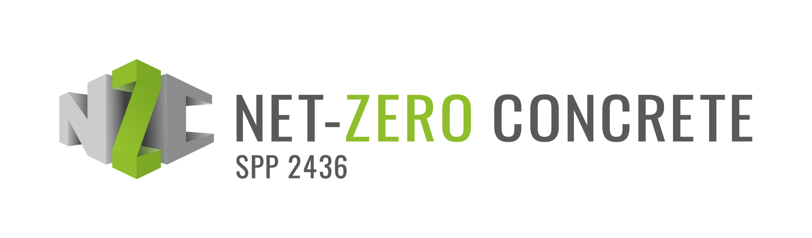
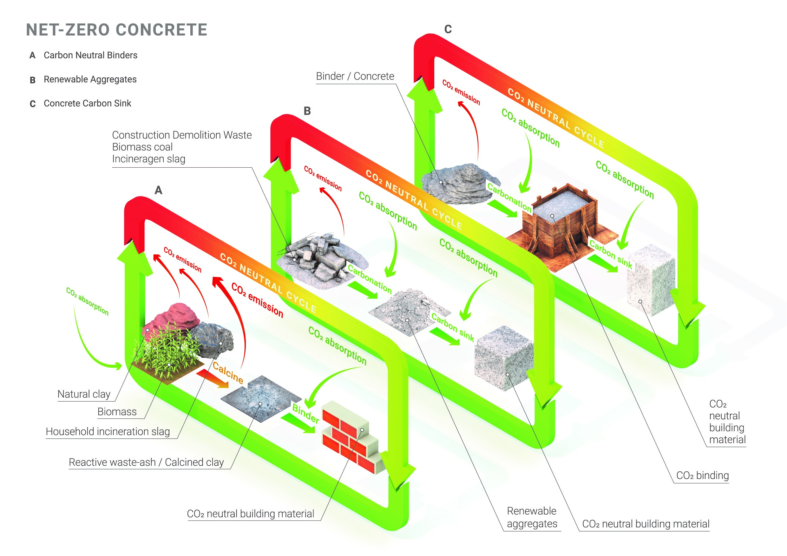

<a href="https://www.wib.tu-darmstadt.de/spp2436/index~1.en.jsp">
  <picture>
    <source media="(prefers-color-scheme: dark)" srcset="assets/spp2436-logo-dark.jpg">
    <source media="(prefers-color-scheme: light)" srcset="assets/spp2436-logo-light.jpg">
    
  </picture>
</a>

# SPP 2436 · Net-Zero Concrete

**Research code and shared methods for pathways toward climate-neutral concrete.**

[About the programme](#about-the-programme) · [Research themes](#research-themes) · [SPP LCA group](lca/README.md) · [Official website](https://www.wib.tu-darmstadt.de/spp2436/index~1.en.jsp)

## About the programme

[SPP 2436 “Net-Zero Concrete”](https://www.wib.tu-darmstadt.de/spp2436/index~1.en.jsp) is a Priority Programme funded by the German Research Foundation (DFG). It brings experimental and modelling research together to explore how concrete can move toward climate neutrality.

This repository is a **code-sharing space for research associated with SPP 2436**. Its first available collection is life cycle assessment (LCA). The [official programme website](https://www.wib.tu-darmstadt.de/spp2436/index~1.en.jsp) provides the full project portfolio, people, and announcements.

## Research themes

The programme's [research concept](https://www.wib.tu-darmstadt.de/spp2436/about_spp_2436/concept_spp2436/index.en.jsp) connects three areas:

[View the concept diagram at full size](assets/spp2436-research-concept.png)

| A · Carbon-neutral binders | B · Renewable aggregates | C · Concrete carbon sink |
| --- | --- | --- |
| Alternative and waste-derived binder systems for lower-impact concrete. | Construction and demolition waste, recycled resources, and renewable aggregates. | Carbonation and the potential of concrete to act as a long-term CO₂ sink. |

## SPP LCA group

The [SPP 2436 LCA working group](https://www.wib.tu-darmstadt.de/spp2436/coordination_researchers/working_groups/life_cycle_assesment/lca_working_group.en.jsp) contributes a cross-cutting environmental assessment perspective to the programme. [Explore the LCA group area](lca/README.md) to find the current research code.

The first collection is the [SCM LCA framework website](lca/scm-framework/README.md), which supports process-data collection, SCM foreground inventories, climate-impact assessment with a separately configured background database, and concrete/mortar/paste recipes. The repository does not contain licensed ecoinvent data.

## Citation and reuse
From Laboratory Characterization to Foreground Life Cycle Inventories: A Process-Based LCA Framework for Waste-Derived Supplementary Cementitious Materials

